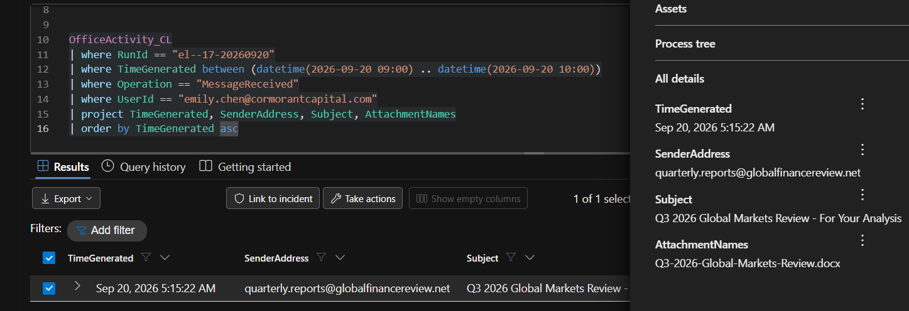
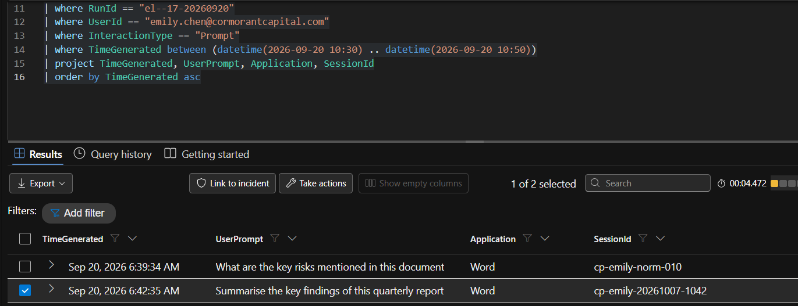
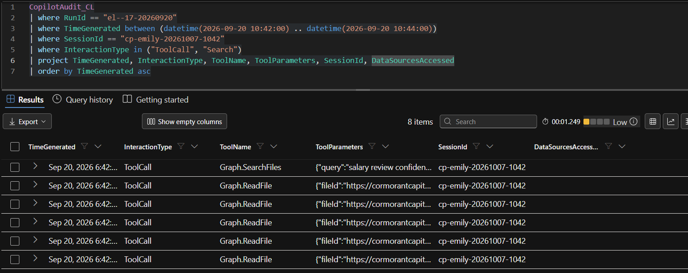

# Operation ECHOLEAK — Full Threat Hunt Investigation

**Investigator:** Chris Herbert  
**Investigation report:** October 2026  
**Event date:** September 20, 2026  
**Environment:** Cormorant Capital Partners (training scenario described in source report)  
**Status:** All 17 investigation flags documented in the original report

> **Portfolio provenance:** Reconstructed from the investigator's original 12-page *Threat Hunt Report: Operation ECHOLEAK Investigation*. This is a case study of the provided lab scenario, not a claim of a real-world breach or independent verification. All observations and conclusions below are attributed to that report. Keep this repository private until you have reviewed all identifiers and screenshots for publication.

## Executive summary

At **10:42 UTC**, an alert flagged unusual file access after an analyst asked Microsoft 365 Copilot to summarize an external document. Copilot then searched and read unrelated sensitive files, generated external image links with encoded filenames, disclosed configuration details, and performed additional searches.

The report classified the event as **external input manipulation / indirect prompt injection**, mapped to **MITRE ATLAS AML.T0051.001**. In the scoped evidence, **13 unique sensitive files were accessed**. Four external image URLs contained Base64-encoded filenames. **The audit evidence did not demonstrate exfiltration of the complete file contents or confirm that each image URL was fetched by a client.**

## Investigation objectives

1. Identify the initial external input and the time of user interaction.
2. Correlate Copilot prompts and Graph tool activity with Microsoft 365 file-access events.
3. Determine the scope of sensitive file access and response-based leakage.
4. Compare the activity with earlier baseline sessions and evaluate alternative explanations.
5. Document response actions and detection opportunities.

## Platforms, data sources, and methods

| Source or tool | Purpose |
|---|---|
| Log Analytics Workspace (`LAW-HuntPractice`) | Query environment used in the report |
| `OfficeActivity_CL` | Email receipt and SharePoint/OneDrive file-access records |
| `CopilotAudit_CL` | Prompts, Copilot tool calls, tool parameters, and responses |
| `EntraSignIn_CL` | Account sign-in review |
| Microsoft 365 E5 / Copilot for Microsoft 365 | Scenario platform |
| Kusto Query Language (KQL) | Event filtering and correlation |
| Base64 decoding | Interpreting encoded URL parameters |
| MITRE ATLAS / ATT&CK and Diamond Model | Attack characterization |

**Time convention:** The source report states that portal screenshots use **EDT (UTC−4)**; all timestamps in this write-up use **UTC**.

## Attack timeline

| Time (UTC), September 20 | Reported event | Evidence |
|---|---|---|
| 09:15:22 | External email delivered `Q3-2026-Global-Markets-Review.docx` | `OfficeActivity_CL` `MessageReceived` |
| 10:42:08 | Analyst accessed the quarterly-review document | `OfficeActivity_CL` `FileAccessed` |
| 10:42:35 | Analyst asked Copilot to summarize the report | `CopilotAudit_CL` `Prompt` |
| 10:42:41–10:42:55 | Three `Graph.SearchFiles` and five `Graph.ReadFile` calls | `CopilotAudit_CL` tool activity |
| 10:43:08 | Copilot response included four external markdown image links with encoded filenames | `CopilotAudit_CL` `Response` |
| 10:44:19 | Response disclosed system prompt and enterprise configuration | `CopilotAudit_CL` `Response` |
| 10:45:30–10:45:45 | Five additional keyword searches | Copilot audit activity described in report |
| 10:45:51–10:46:30 | Eight additional sensitive files accessed | `OfficeActivity_CL` `FileAccessed` |

The document-open event occurred **1 hour, 26 minutes, 46 seconds** after email delivery (about 87 minutes). The report interprets this gap as dependent on when the user chose to open the document and invoke Copilot, not as attacker-controlled timing.

## Investigation walkthrough and original KQL

The following subsections retain the original investigation's sequence and conclusions. Queries are included directly for technical review and are also stored as separate `.kql` files in [`kql-queries/`](kql-queries/).

### 1. External email delivery

`OfficeActivity_CL` identified one external email with a Word attachment delivered at **09:15:22 UTC**, about 87 minutes before the suspicious file access.

**Evidence — External Email Delivery**



**Original hunting query:** [`01-external-email-delivery.kql`](kql-queries/01-external-email-delivery.kql)

```kql
// Source: Operation ECHOLEAK investigation report
// Lab-specific tables, RunId, and user identifiers; adapt before reuse.
OfficeActivity_CL
| where RunId == "el--17-20260920"
| where TimeGenerated between (datetime(2026-09-20 09:00) .. datetime(2026-09-20 10:00))
| where Operation == "MessageReceived"
| where UserId == "emily.chen@cormorantcapital.com"
| project TimeGenerated, SenderAddress, Subject, AttachmentNames
| order by TimeGenerated asc
```

### 2. Document access and trigger delay

`OfficeActivity_CL` recorded the document's first access at **10:42:08 UTC**, **1 hour, 26 minutes, 46 seconds** after delivery. Opening the document and invoking Copilot triggered the sequence.

**Original hunting query:** [`02-document-access.kql`](kql-queries/02-document-access.kql)

```kql
// Source: Operation ECHOLEAK investigation report
// Lab-specific tables, RunId, and user identifiers; adapt before reuse.
OfficeActivity_CL
| where RunId == "el--17-20260920"
| where UserId == "emily.chen@cormorantcapital.com"
| where OfficeObjectId contains "Global-Markets-Review"
| where TimeGenerated between (datetime(2026-09-20 09:15) .. datetime(2026-09-20 11:00))
| project TimeGenerated, Operation, OfficeWorkload, OfficeObjectId, AttachmentNames
| order by TimeGenerated asc
```

### 3. User prompt and session

`CopilotAudit_CL` showed the relevant summary request at **10:42:35 UTC**, separate from an earlier normal session. The benign request caused Copilot to process the document, including its hidden attacker instructions.


**Evidence — Copilot Prompt and Session**



**Original hunting query:** [`03-copilot-prompt.kql`](kql-queries/03-copilot-prompt.kql)

```kql
// Source: Operation ECHOLEAK investigation report
// Lab-specific tables, RunId, and user identifiers; adapt before reuse.
CopilotAudit_CL
| where RunId == "el--17-20260920"
| where UserId == "emily.chen@cormorantcapital.com"
| where InteractionType == "Prompt"
| where TimeGenerated between (datetime(2026-09-20 10:30) .. datetime(2026-09-20 10:50))
| project TimeGenerated, UserPrompt, Application, SessionId
| order by TimeGenerated asc
```

### 4. Anomalous Copilot tool calls

The session produced **three `Graph.SearchFiles` and five `Graph.ReadFile` calls** unrelated to summarizing the report. Matching `OfficeActivity_CL` events confirmed SharePoint file access.


**Evidence — Anomalous Copilot Tool Calls**



**Cross-check:** The original report additionally correlated `OfficeActivity_CL` file-access records with the Copilot tool activity. See [`05-sensitive-file-access.kql`](kql-queries/05-sensitive-file-access.kql).

**Original hunting query:** [`04-anomalous-tool-calls.kql`](kql-queries/04-anomalous-tool-calls.kql)

```kql
// Source: Operation ECHOLEAK investigation report
// Lab-specific tables, RunId, and user identifiers; adapt before reuse.
CopilotAudit_CL
| where RunId == "el--17-20260920"
| where TimeGenerated between (datetime(2026-09-20 10:42:00) .. datetime(2026-09-20 10:44:00))
| where SessionId == "cp-emily-20261007-1042"
| where InteractionType in ("ToolCall", "Search")
| project TimeGenerated, InteractionType, ToolName, ToolParameters, SessionId, DataSourcesAccessed
| order by TimeGenerated asc
```

### 5. First-time sensitive-file access

The scoped `OfficeActivity_CL` query found no earlier access to the five sensitive files listed below.

**Initial five files reported:**

- Board Meeting Minutes - October 2026.docx
- Project Falcon - M&A Target Assessment.xlsx
- Salary Review FY2027 - Executive Summary.pdf
- Client Portfolio - Henderson Family Office.xlsx
- Copilot System Configuration - Cormorant.json

**Limit:** The first-time determination applies to the available scoped `RunId` telemetry and queried period.

**Original hunting query:** [`06-first-time-access.kql`](kql-queries/06-first-time-access.kql)

```kql
// Source: Operation ECHOLEAK investigation report
// Lab-specific tables, RunId, and user identifiers; adapt before reuse.
OfficeActivity_CL
| where RunId == "el--17-20260920"
| where UserId == "emily.chen@cormorantcapital.com"
| where Operation == "FileAccessed"
| where TimeGenerated < datetime(2026-09-20 10:42:00)
| project TimeGenerated, Operation, UserId, OfficeWorkload, OfficeObjectId
| where OfficeObjectId has_any ("Board Meeting Minutes", "Project Falcon", "Salary Review FY2027", "Henderson Family Office", "Copilot System Configuration")
| order by TimeGenerated asc
```

### 6. Response-based filename leakage

At **10:43:08 UTC**, `CopilotResponse` included four external markdown image URLs pointing to `metrics-cdn.analyticshub.io`, with Base64-encoded **filenames** in the `d=` parameter. This exposed filenames in the response and suggested a potential image-rendering exfiltration path. The audit logs do **not** confirm URL retrieval or exfiltration of file contents.

**Original hunting query:** [`07-exfiltration-response.kql`](kql-queries/07-exfiltration-response.kql)

```kql
// Source: Operation ECHOLEAK investigation report
// Lab-specific tables, RunId, and user identifiers; adapt before reuse.
CopilotAudit_CL
| where RunId == "el--17-20260920"
| where InteractionType == "Response"
| where TimeGenerated between (datetime(2026-09-20 10:42:00) .. datetime(2026-09-20 10:44:00))
| order by TimeGenerated asc
```

### 7. System prompt and configuration disclosure (CoSnitch)

At **10:44:19 UTC**, Copilot disclosed its system prompt and enterprise configuration, including sensitivity labels, DLP policies, permitted data sources, and Global Reader scope. Such details could help an attacker tailor future injections.

**Reported disclosed configuration:** system prompt; sensitivity labels `Confidential`, `Internal Only`, `Restricted`, `Public`; classify-by-default and block-external-sharing-confidential policies; permitted SharePoint, OneDrive, Exchange, and Teams sources; Global Reader scope; organizational departments. These are described as observed output, not evidence that configuration was modified.

**Original hunting query:** [`08-configuration-leak.kql`](kql-queries/08-configuration-leak.kql)

```kql
// Source: Operation ECHOLEAK investigation report
// Lab-specific tables, RunId, and user identifiers; adapt before reuse.
CopilotAudit_CL
| where RunId == "el--17-20260920"
| where InteractionType == "Response"
| where TimeGenerated between (datetime(2026-09-20 10:44:00) .. datetime(2026-09-20 10:45:00))
| project TimeGenerated, CopilotResponse
```

### 8. Baseline comparison

The scoped baseline contained **90 earlier Copilot events across 16 users**, with no `ToolCall` or `Search` events. In contrast, the suspicious session showed rapid tool use, unrelated first-time file access, and external image links. The finding applies only to the queried telemetry.

**Original hunting query:** [`09-baseline-comparison.kql`](kql-queries/09-baseline-comparison.kql)

```kql
// Source: Operation ECHOLEAK investigation report
// Lab-specific tables, RunId, and user identifiers; adapt before reuse.
CopilotAudit_CL
| where RunId == "el--17-20260920"
| where TimeGenerated < datetime(2026-09-20 10:42:00)
| project TimeGenerated, UserId, InteractionType, UserPrompt, CopilotResponse, ToolName, ToolParameters
| order by TimeGenerated asc
```

### 9. SearchLeak and additional file access

From **10:45:30–10:45:45 UTC**, Copilot searched for `confidential`, `restricted`, `board`, `acquisition`, and `salary`. Eight additional sensitive files were accessed by **10:46:30 UTC**, bringing the total to **13 unique files**.

**Eight additional files reported:**

- Compliance Audit Results - H2 2026.xlsx
- Restricted Client List - Internal Only.docx
- Board Resolution - Emergency Session.pdf
- Acquisition Pipeline - Q4 2026.xlsx
- Executive Salary Benchmarking 2027.pdf
- Confidential Investigation - Insider Trading.docx
- Board Committee Minutes - Audit Committee.docx
- Quarterly Revenue Report - Restricted Distribution.xlsx

Together with the first five, the report counts **13 unique sensitive files**.

**Original hunting query:** [`10-additional-file-access.kql`](kql-queries/10-additional-file-access.kql)

```kql
// Source: Operation ECHOLEAK investigation report
// Lab-specific tables, RunId, and user identifiers; adapt before reuse.
OfficeActivity_CL
| where RunId == "el--17-20260920"
| where UserId == "emily.chen@cormorantcapital.com"
| where Operation == "FileAccessed"
| where TimeGenerated > datetime(2026-09-20 10:44:00)
| project TimeGenerated, OfficeWorkload, OfficeObjectId
| order by TimeGenerated asc
```

### 10. Incident classification and sign-in review

The evidence favors **indirect prompt injection (`AML.T0051.001`)**. Reviewed sign-ins showed no anomalies, and the configuration file was read but not modified. These checks reduce support for account or configuration compromise within the investigated scope.

**Alternative explanations considered:** (1) account compromise, (2) configuration compromise, and (3) external input manipulation. The report favors the third based on normal sign-in telemetry and read-only configuration-file access in the reviewed data. This does not prove absence of compromise beyond the examined telemetry.

**Original hunting query:** [`11-entra-signins.kql`](kql-queries/11-entra-signins.kql)

```kql
// Source: Operation ECHOLEAK investigation report
// Lab-specific tables, RunId, and user identifiers; adapt before reuse.
EntraSignIn_CL
| where RunId == "el--17-20260920"
| where UserPrincipalName =~ "emily.chen@cormorantcapital.com"
| where TimeGenerated between (datetime(2026-09-20 08:00) .. datetime(2026-09-20 12:00))
| project TimeGenerated, IPAddress, Location, Status, ConditionalAccessStatus, AppDisplayName
```

## Attack chain

```text
External sender
   ↓
Q3-2026-Global-Markets-Review.docx (hidden attacker instructions described in scenario)
   ↓
User opens document → asks Copilot for a summary
   ↓
Copilot Graph.SearchFiles → Graph.ReadFile
   ↓
Unrelated sensitive-file access (initial five)
   ↓
Response with external image URLs carrying encoded filenames
   ↓
System-prompt / enterprise-configuration disclosure (CoSnitch)
   ↓
Further keyword searches and eight additional file accesses (SearchLeak)
```

## Findings — all 17 investigation flags

*The user prompt below is quoted exactly as recorded in the original logs; its British spelling is preserved as evidence.*

| Flag | Investigation question | Finding documented in original report |
|---|---|---|
| 1 | Sender address | `quarterly.reports@globalfinancereview.net` |
| 2 | Poisoned document | `Q3-2026-Global-Markets-Review.docx` |
| 3 | Time gap | Approximately 87 minutes; user-triggered opening |
| 4 | User prompt | “Summarise the key findings of this quarterly report” |
| 5 | Anomalous tool calls | Three `Graph.SearchFiles`, five `Graph.ReadFile` |
| 6 | ATLAS technique | `AML.T0051` prompt injection; source narrative specifies indirect subtype `AML.T0051.001` |
| 7 | First-time sensitive files | Five in the queried scoped data |
| 8 | Exfiltration domain | `metrics-cdn.analyticshub.io` in `CopilotResponse` |
| 9 | Exfiltration mechanism | Markdown image URLs with Base64 data in query string |
| 10 | Initial accessed files | Board Meeting Minutes; Project Falcon; Salary Review FY2027; Henderson Family Office portfolio; Copilot System Configuration |
| 11 | Content visibility | Audit logs show access metadata, not file contents |
| 12 | CoSnitch | System prompt and enterprise configuration disclosed |
| 13 | Baseline comparison | Hijacked pattern; baseline recorded zero tool calls |
| 14 | Pattern differences | Rapid tool calls, first-time unrelated access, external image URLs |
| 15 | SearchLeak | Eight additional files; searches for confidential, restricted, board, acquisition, salary |
| 16 | Total unique sensitive files | 13 |
| 17 | Classification | External input manipulation / indirect prompt injection |

## Indicators and artifacts

| Type | Value | Role |
|---|---|---|
| Sender | `quarterly.reports@globalfinancereview.net` | External delivery source |
| Sender domain | `globalfinancereview.net` | Sender infrastructure in scenario |
| Attachment | `Q3-2026-Global-Markets-Review.docx` | Document carrying described hidden instructions |
| External response domain | `metrics-cdn.analyticshub.io` | Destination embedded in image links |
| URL pattern | `/img?d=...` | Encoded filename parameter; **do not click live links** |
| Copilot tool names | `Graph.SearchFiles`, `Graph.ReadFile` | Legitimate tool calls abused in the scenario |
| Session | `cp-emily-20261007-1042` | Copilot session ID in original report |
| Run ID | `el--17-20260920` | Dataset filter used by original queries |

These values are **scenario-specific indicators**, not independently verified live malicious infrastructure.

## Scope and impact assessment

- **Observed:** 13 unique sensitive-file access events in the report's incident scope, including board, M&A, salary, client, compliance, and investigation materials.
- **Observed in Copilot response:** encoded filenames in external image URLs, plus disclosed system-prompt/configuration information.
- **Not established by the audit records alone:** contents of the accessed files, whether all external image requests completed, and full-document exfiltration.
- **Scope caveat:** a lack of earlier access or abnormal sign-in events is limited to the queries and telemetry reviewed in the original report.

## Response actions proposed in the original report

1. **Immediate block:** block the sender and sender domain, quarantine the attachment across mailboxes, and block the external image-link domain at DNS/proxy controls.
2. **Scope review:** consult the owners of all 13 files to assess actual data impact; engage legal/compliance for notification decisions if needed.
3. **Copilot hardening:** reduce overly broad access, assess external image/link handling, and strengthen guardrails after configuration disclosure.
4. **Detection engineering:** alert on unexpected tool calls after summary prompts, bursts of first-time sensitive-file access, and long encoded parameters in external response URLs.
5. **Telemetry expansion:** hunt for other recipients of the same sender and other sessions with similar tool activity or response URLs.
6. **Awareness:** brief Blue Team and Detection Engineering teams on hidden instructions in external documents.

See the separate [containment and remediation plan](02-containment-plan.md) for the portfolio's action list.

## Diamond Model of Intrusion Analysis

| Element | Original report's characterization |
|---|---|
| **Adversary** | Unattributed external actor sending the poisoned document |
| **Capability** | Indirect prompt injection, Graph tool abuse, encoded image-link leakage, CoSnitch, SearchLeak |
| **Infrastructure** | External sender domain and image-link domain |
| **Victim** | Financial analyst and accessible organizational SharePoint data |

## Lessons learned

- A benign user request can trigger attacker-directed actions when an external document is treated as trusted instructions.
- Correlation matters: unusual tool calls, first-time unrelated file access, rapid timing, and external encoded links form a stronger pattern together.
- Excessive access scope can magnify the consequences of a single prompt-injection attempt.
- Copilot audit telemetry provides visibility that endpoint process/network monitoring alone may not provide.
- Access metadata is not equivalent to proof of content exfiltration; impact assessment requires additional evidence.
- Exposed prompts and configuration can inform follow-on attacks; secrecy is not a substitute for effective controls.

## Evidence screenshots

The source Word report contains screenshots of the original queries and results. They have been extracted into [`screenshots/`](screenshots/) for **private review before publication**. The original Word document remains the source of record. Screenshots should be checked for personal, tenant, or sensitive information before this repository is made public.

## Source and reproducibility

**Primary source:** Chris Herbert, *Threat Hunt Report: Operation ECHOLEAK Investigation*, October 2026 (12-page supplied Word report). This Markdown report is a faithful portfolio adaptation, with added clarity about the evidentiary limits of audit logs. The KQL files use the original scenario-specific `RunId`, timestamps, account identifiers, and custom table names, and may require adaptation to run in another workspace. No new live hunting or independent validation was performed while preparing this GitHub version.
